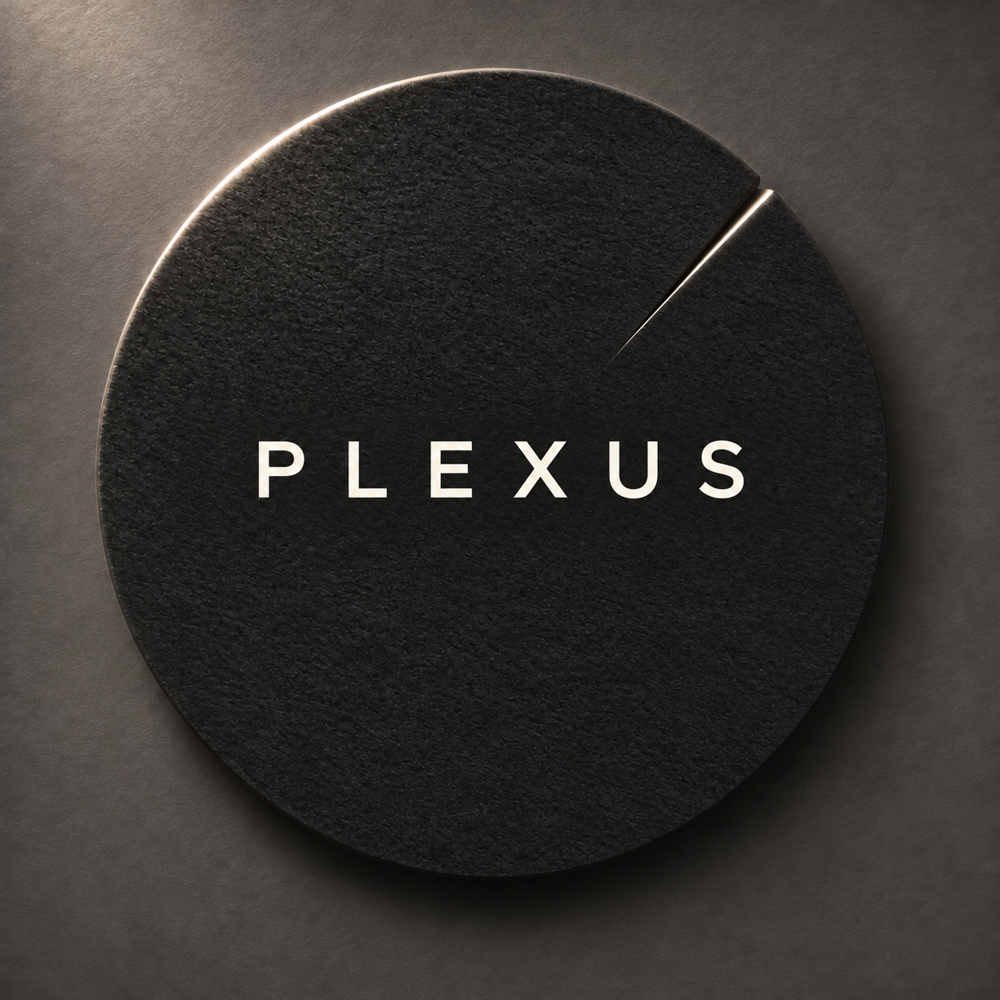
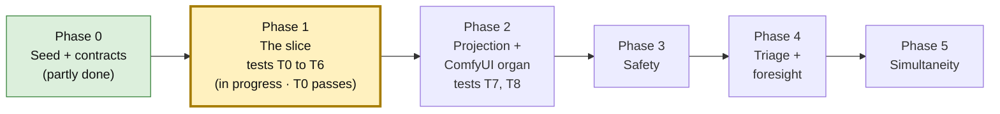
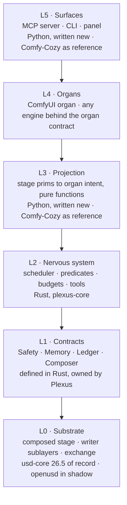
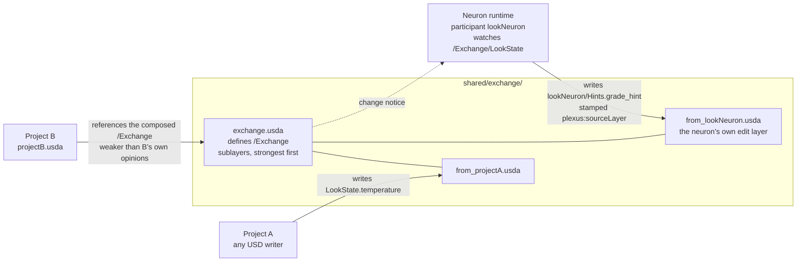

<p align="center">
  
</p>

# Plexus

**Projects that compose into each other while they run.**

Plexus is a runtime where **OpenUSD composition is the source of truth.** Agents, called **neurons**, stay dormant until a cheap, exact check on the stage fires. Render and compute engines plug in as swappable **organs**.

*Plexus is a working title.*

---

## Where it stands · Nov 2, 2026

**Phase 1: 1 of 11 frozen tests passes** (T0, the schema gate), on `plexus-loop/acceptance`. Nothing is merged.

| Done | Not yet |
|---|---|
| Blueprint v5.3, Engineering Spec v2.1, Phase 1 tests frozen (11) | T1 to T6: propagation, predicates, budget, provenance, gate, truth |
| Scaffold: `plexus/` package, `crates/plexus-core` Cargo workspace, PyO3 builds | The four contracts: Safety, Memory, Ledger, Composer |
| The build harness, `harness/plexus_loop/`, and its first run (5 attempts, 1 kept) | |

**Next step:** the next batch of `acceptance` attempts, run from the kept commit `4e494b3`. The reply-handling fix that blocked attempts 2 to 5 has landed (`15bc013`). Where the last session stopped: [`harness/CAPSULE.md`](harness/CAPSULE.md).

---

## The idea, in three lines

| Idea | What it means in practice |
|---|---|
| **The stage is the truth** | Every project is a USD layer. Composition settles conflicts. No locks, no merges, no hidden runtime state. |
| **Wake only when needed** | A neuron stays dormant until its predicate comes true, for example `delta(/Exchange/LookState.temperature) > 0.2`. A budget caps how often it can wake. |
| **Engines are organs** | ComfyUI, Houdini or anything else sits behind one organ contract, so it can be swapped. |

---

## You are here



---

## How it fits together

**Each layer calls only the layer below it, or a contract.** Rust goes where code is hot, long-running or must be exact. Python stays where code must be flexible, or where what Plexus calls is Python-only: usd-core (Pixar ships no official Rust bindings) and the LLM SDKs.



**When something Plexus depends on is missing, the call says so.** It never reports success from a stub. Safety fails closed, memory narrows to the local stage, and the ledger queues claims for later.

---

## The first slice (Phase 1)

**Two projects meet only through one shared exchange.**

1. Project A changes a value.
2. Project B sees the change in under 250 ms.
3. A neuron wakes and writes a hint into its own layer.
4. B sees the hint, stamped with the layer it came from.



### The tests that define "done"

They live in `tests/acceptance/` and are frozen: only Joe may change them.

| Test | In plain words |
|---|---|
| **T0** · Schema gate | The four Plexus schemas register in USD, and every attribute survives a save and reload. |
| **T1** · Propagation | A's change shows up in B in under 250 ms (95th percentile over 50 tries). |
| **T2** · Predicate precision | A 0.3 change wakes the neuron once, a 0.1 change never does, and two 0.15 changes wake it once. A bad predicate fails at registration. |
| **T3** · Budget | Wakes over the budget are refused. Three refused in a row mute the neuron, and the stage says so. |
| **T4** · Provenance | The neuron's hint names the layer it came from, and B's property stack agrees. |
| **T5** · Gate | A write outside the neuron's allowlist is dropped and flagged. One inside lands. |
| **T6** · Truth | Kill both processes, reopen the files, and every value is still there. |
| T7 · Round trip *(Phase 2)* | A job goes through the ComfyUI organ and comes back only once the engine's history really has it. The stage holds the file's path and hash, never its bytes. |
| T8 · Blindness *(Phase 2)* | No ComfyUI vocabulary appears outside the ComfyUI organ. |

More pictures, including the wake pipeline and the Python/Rust split: **[docs/plexus/DIAGRAMS.md](docs/plexus/DIAGRAMS.md)**.

---

## How Plexus gets built

**Claude plans and reviews. A local model makes the attempts. Joe decides what gets promoted.**

An attempt is kept only when every gate passes (`layers`, `core`, `cargo`, `unit`) and at least one more frozen test passes. Eight drops in a row, the budget, or a stop file ends the run. Nothing merges by itself. The full loop is drawn in [Diagrams §6](docs/plexus/DIAGRAMS.md#6--build-harness).

### Run it

**Step 1 of 3 · Check the mission.** Says whether the next attempt would run on the CPU or the GPU.

```
python -m harness.plexus_loop check harness/plexus_loop/missions/acceptance.toml
```

**Step 2 of 3 · Run it.** Works until a budget or a stop condition ends it.

```
python -m harness.plexus_loop run harness/plexus_loop/missions/acceptance.toml
```

**Step 3 of 3 · Stop it early, if you need to.** The run halts after its current attempt.

```
python -m harness.plexus_loop stop
```

**From Claude Code,** the same loop has three commands:

| Command | What it does |
|---|---|
| `/doctor` | Checks Ollama and the model, Rust, maturin, usd-core 26.5, Houdini, and the harness. |
| `/mission acceptance` | Setup, plan, stop for Joe, then run and review on his go. |
| `/report` | Writes the mission report and refreshes `harness/CAPSULE.md`. |

### What you need

| Tool | Version | Why |
|---|---|---|
| Python | 3.11 or newer (3.14 is used today) | Host process |
| usd-core | 26.5 exactly: `pip install usd-core==26.5 pytest` | Composer of record; matches Houdini 22's USD 0.26.5. The root `pyproject.toml` is still the comfy-cozy package until `plexus/` packaging lands. |
| Rust | stable, with cargo | Builds `plexus._core`. The `core` gate runs cargo and copies the library into `plexus/`. This mission doesn't use maturin. |
| Ollama | with `qwen3-coder:30b` pulled | The harness's default worker |

---

## Where things live

| Path | What it is | Who may change it |
|---|---|---|
| `plexus/` | New Plexus Python *(scaffold here; the kept schema plugin is on `plexus-loop/acceptance`)* | The worker, through the harness |
| `crates/`, `Cargo.toml` | Rust core `crates/plexus-core`, built by the `core` gate into `plexus/_core.pyd`, imported as `plexus._core` | The worker, through the harness |
| `tests/acceptance/` | The frozen judge, plus `CONTRACT.md`, the Python surface the tests call | Joe only |
| `harness/plexus_loop/` | The build harness, its `program.md` and mission files | Joe, and Claude when Joe says so |
| `docs/plexus/` | Blueprint v5.3, memory options, diagrams, the Nov 1 package | Joe |
| `PLEXUS_SPEC.md` | Engineering Spec v2.1 + Patch 01 | Joe |
| `agent/`, `cognitive/`, `panel/`, … | Seeded Comfy-Cozy code, kept as history for now. Plexus doesn't build on it. | Joe decides whether it stays; conventions in `CLAUDE.cozy.md` |

---

## Rules that don't bend

- **Nothing from Synapse comes into Plexus.** No code, imports, packages, shared contracts or dependencies. It is one architectural reference among several.
- **Plexus runs without SALUS, Moneta and Hanish.** Each is optional, behind an adapter Plexus writes.
- **Branches only.** Nothing pushes to `main` or merges into it. Main moves by pull request.
- **The frozen tests define done.** Nothing edits, skips or re-marks them except Joe.
- **Houdini open, or can't tell? Then CPU.** The harness does this itself.

The hooks in `.claude/settings.json` enforce these. `CLAUDE.md` explains them.

---

## Read next

| If you want… | Read |
|---|---|
| The architecture and its decisions | [`docs/plexus/PLEXUS_BLUEPRINT_v5.md`](docs/plexus/PLEXUS_BLUEPRINT_v5.md) |
| Exactly what gets tested | [`PLEXUS_SPEC.md`](PLEXUS_SPEC.md) and [`tests/acceptance/CONTRACT.md`](tests/acceptance/CONTRACT.md) |
| Every diagram in one place | [`docs/plexus/DIAGRAMS.md`](docs/plexus/DIAGRAMS.md) |
| How the harness works | [`harness/plexus_loop/README.md`](harness/plexus_loop/README.md) and [`program.md`](harness/plexus_loop/program.md) |
| Where the last session stopped | [`harness/CAPSULE.md`](harness/CAPSULE.md) |
| The words Plexus uses | [`docs/plexus/VOICE.md`](docs/plexus/VOICE.md) |

---

## Comfy-Cozy, the predecessor

**Plexus is the next generation of Comfy-Cozy, built from the ground up.** Comfy-Cozy (`G:\Comfy-Cozy` on Joe's machine) is an architecture reference only: new Plexus code copies nothing from it and imports nothing from it.

This repo started as a clone of Comfy-Cozy, so it still carries Comfy-Cozy's history and the seeded `agent/` and `cognitive/` code. Plexus doesn't build on that code, and whether it stays is Joe's call. **The Comfy-Cozy README moved to [`README.cozy.md`](README.cozy.md).** Its conventions are in [`CLAUDE.cozy.md`](CLAUDE.cozy.md).

## License

MIT. See [`LICENSE`](LICENSE). Comfy-Cozy's MIT notice is kept.
