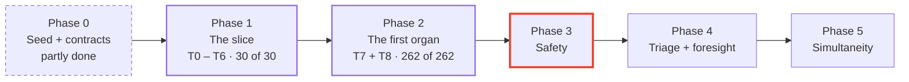
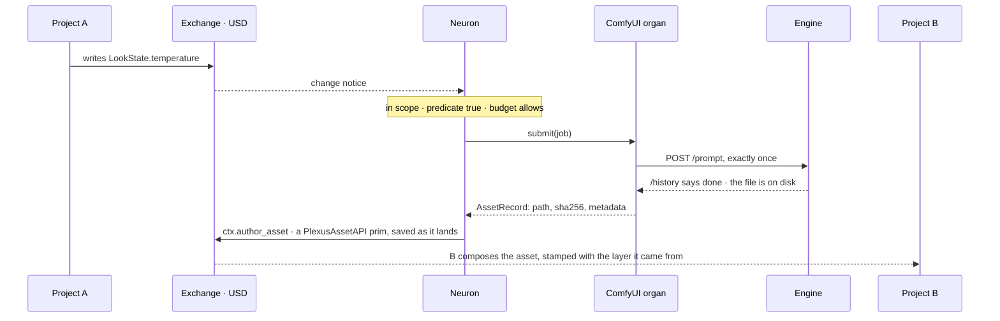
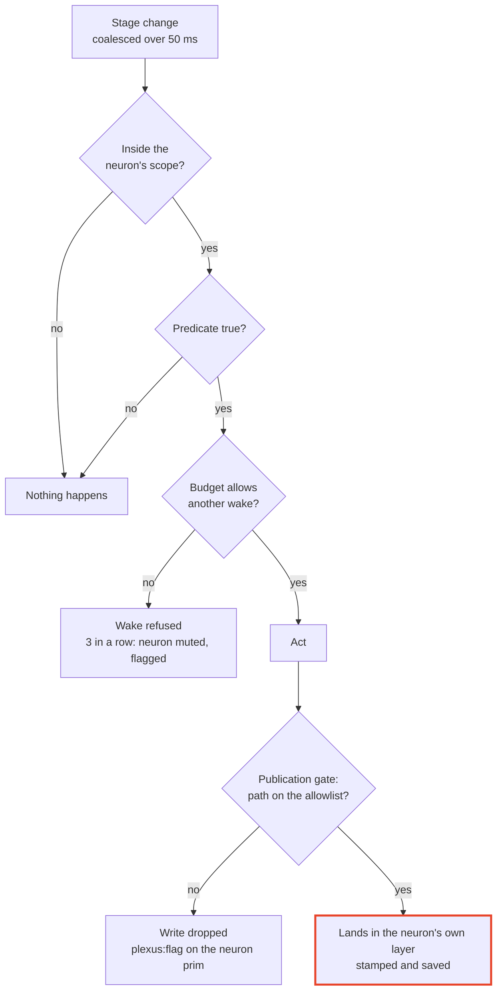
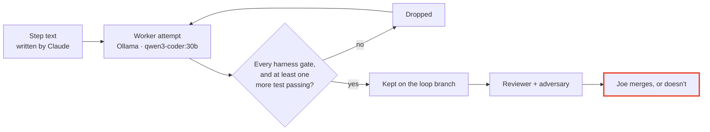

<p align="center">
  <picture>
    <source media="(prefers-color-scheme: dark)" srcset="assets/plexus-wordmark-dark.svg">
    
  </picture>
</p>

<p align="center">
  <strong>Projects that compose into each other while they run.</strong>
</p>

<p align="center">
  OpenUSD runtime &nbsp;·&nbsp; Rust core, Python around it &nbsp;·&nbsp; <code>plexus-0.1.0-alpha.11</code> &nbsp;·&nbsp; <a href="LICENSE">MIT</a>
</p>

---

## The 30-second version

> **Every project is a USD layer, and composition is the only source of truth.**
> Agents, called **neurons**, stay **dormant** until a cheap, exact check on the stage comes true.
> Engines such as ComfyUI plug in as swappable **organs**, and their results land on the stage as assets.

| | |
|---|---|
| **Where it stands** | As of `plexus-0.1.0-alpha.11`, Phase 1 and Phase 2 are done. Every frozen phase 1 and phase 2 test passes on Windows: **30 of 30** and **262 of 262**. Organs sit on the stage, and Plexus can start, stop and measure a ComfyUI through comfy-cli. Given an instance folder, that ComfyUI keeps its own user folder, database, temp folder and output; on Windows its process tree is held in a Job Object, and it starts suspended so nothing it starts escapes that tree. |
| **What's next** | Phase 3, Safety: the four contracts. Mission M3.3, which would close alpha.11's own open list, is the alternative. The latest state is in [`harness/CAPSULE.md`](harness/CAPSULE.md). |
| **Start here** | [01 · The idea](#01--the-idea) for why, [05 · Run it](#05--run-it) for how. One diagram of a round trip is in [03](#03--how-it-works); the rest is below that. |
| **The one number that matters** | **292 acceptance tests pass**, 30 in phase 1 and 262 in phase 2, and the full suite has no failures. Everything else here is how. |

*Plexus is a working title.*

---

## 01 · The idea

**Three rules carry the whole design.**

| | Rule | In practice |
|---|---|---|
| **1** | **The stage is the truth** | Every project is a USD layer. Composition settles conflicts. No locks, no merges, no hidden runtime state. |
| **2** | **Wake only when needed** | A neuron stays dormant until its predicate comes true, for example `delta(/Exchange/LookState.temperature) > 0.2`. A budget caps how often it can wake. |
| **3** | **Engines are organs** | ComfyUI, Houdini or anything else sits behind one organ contract, so it can be swapped. The core never learns an engine's words. |

---

## 02 · Where it stands

**Two phases done, three ahead.** The outlined box is the next one.



| Done | Not yet |
|---|---|
| **Phase 1:** schemas, propagation in under 250 ms, predicates, budgets, provenance, the publication gate, truth on disk | **The four contracts:** Safety, Memory, Ledger, Composer |
| **Phase 2:** the ComfyUI organ behind the organ contract, `ctx.author_asset`, organs on the stage (`publish_organ`, `publish_organ_state`), ComfyUI's lifecycle through comfy-cli (`CozyLifecycle`), an instance folder per ComfyUI, a Job Object around its process tree with a suspended start, and a core with no engine words in it | **A real engine on every release:** the frozen tests run against a fake ComfyUI. The live job test (`tests/acceptance/live/`, 5 cases) last passed on the organ from mission `organ-live`, before alpha.8, and has not run since. `CozyLifecycle` ran by hand against the real comfy-cli three times on Nov 11, the last on alpha.10's code with an instance folder (11 of 11 checks) |
| **The build harness**, `harness/plexus_loop/`, with seven missions run: `acceptance`, `organ`, `organ-live`, `organ-registry`, `organ-lifecycle`, `organ-isolation` and `organ-hardening` | **Packaging:** nothing is on `main` yet |

**Releases:** pre-releases only, tagged `plexus-*` on the mission branch. The latest is [`plexus-0.1.0-alpha.11`](https://github.com/JosephOIbrahim/Plexus/releases/tag/plexus-0.1.0-alpha.11). Where the last session stopped: [`harness/CAPSULE.md`](harness/CAPSULE.md).

---

## 03 · How it works

**Each layer calls only the layer below it, or a contract.** Six of them, top to bottom: surfaces (MCP server, CLI), **organs** (ComfyUI and anything else behind the organ contract), projection (stage prims to organ intent), the **nervous system** (predicates and budgets in the Rust core, neurons in Python), four contracts (Safety, Memory, Ledger, Composer), and the substrate (the composed stage, writer sublayers, the exchange). Rust goes where code is hot, long-running or must be exact; Python stays where it must be flexible, or where what Plexus calls is Python-only — usd-core and the LLM SDKs. The two in bold are the ones with code today.

**One round trip, end to end.** This is what T7 checks.



**When something Plexus depends on is missing, the call says so.** It never reports success from a stub. Safety fails closed, memory narrows to the local stage, and the ledger keeps claims for later.

<details>
<summary><strong>The wake pipeline, check by check</strong></summary>

**A neuron runs only when every check on the way says yes.** The order is fixed (Spec §6).



- **The delta cache updates only on a wake.** Small changes add up until they cross the threshold.
- **A mute is never silent.** It is an opinion on the neuron prim, with a flag beside it.
- **Every opinion is saved as it lands.** Reopening the files reproduces the whole session.

</details>

More pictures, including the Rust and Python notice path: **[docs/plexus/DIAGRAMS.md](docs/plexus/DIAGRAMS.md)**.

---

## 04 · The tests that define done

**They live in `tests/acceptance/` and are frozen.** Only Joe places or changes them. Every phase 1 and phase 2 test passes today. The live file needs a running ComfyUI, so normal runs leave it out.

| Test | In plain words |
|---|---|
| **T0** · Schema gate | The four Plexus schemas register in USD, and every attribute survives a save and reload. |
| **T1** · Propagation | A's change shows up in B in under 250 ms, 95th percentile over 50 tries. |
| **T2** · Predicate precision | A 0.3 change wakes the neuron once, a 0.1 change never does, two 0.15 changes wake it once. |
| **T3** · Budget | Wakes over the budget are refused. Three refused in a row mute the neuron, and the stage says so. |
| **T4** · Provenance | The neuron's hint names the layer it came from, and B's property stack agrees. |
| **T5** · Gate | A write outside the neuron's allowlist is dropped and flagged. One inside lands. |
| **T6** · Truth | Kill both processes, reopen the files, and every value is still there. |
| **T7** · Round trip | A job goes through the ComfyUI organ and returns only once the engine's history really has it. The stage holds the file's path and hash, never its bytes. |
| **T8** · Blindness | No ComfyUI word appears anywhere in the core, outside the organ itself. |

<details>
<summary><strong>The frozen files beyond T0 to T8</strong></summary>

| File | Holds |
|---|---|
| `phase1/` | Five more files read what T0 to T6 leave open: budget order, the window burst, the mute's isolation, truth on disk, and a refused Save that stops no neuron. |
| `phase2/test_organ_surface.py` | 58 items: every clause of the organ contract that T7 and T8 don't read. |
| `phase2/test_asset_whole_or_nothing.py` | A value of the wrong type raises, and nothing of the asset lands in the file. |
| `phase2/test_organ_malformed.py` | 13 malformed engine replies, each ending in an `OrganError`. |
| `phase2/test_organ_registry.py` | 40 cases: `publish_organ` puts an organ's profile on the stage under `/Plexus/Organs`. |
| `phase2/test_organ_reply_shapes.py` | 51 more reply shapes the organ cannot read, each ending in an `OrganError`. |
| `phase2/test_organ_history_reads.py` | 8 cases: a null history status reads as done, and a broken `/history` reply fails at once. |
| `phase2/test_organ_state.py` | 15 cases: `publish_organ_state` puts an organ's lifecycle on its prim, and a neuron wakes on it. |
| `phase2/test_organ_lifecycle.py` | 19 cases: `CozyLifecycle` starts, stops and measures ComfyUI through a fake comfy-cli, and never touches port 8188. |
| `phase2/test_organ_isolation.py` | 20 cases: an instance folder keeps ComfyUI's user folder, database, temp folder and output out of the workspace, and on Windows nothing the lifecycle started outlives `stop()` or its host. |
| `phase2/test_organ_hardening.py` | 24 cases: on Windows the root starts suspended and is resumed only once the job holds it; a hold that fails kills it before it runs; abbreviated folder flags and an instance inside the workspace's temp folder are refused; an instance another lifecycle holds is refused. |
| `phase2/test_organ_hardening_posix.py` | 3 cases, on POSIX only: the root's group is signalled only while the root is unreaped, a refused kill is an `OrganError` that `stop()` can retry, and an engine that outlives its host keeps its instance. |
| `live/test_organ_live.py` | 5 cases against a real ComfyUI. Marked `integration`, so it runs only by hand. |
| `CONTRACT.md` | The Python surface every test calls. Everything below it is free. |

</details>

---

## 05 · Run it

**Claude plans and reviews. A local model makes the attempts. Joe decides what gets promoted.**



**Step 1 of 3 · Check the mission.** Says whether the next attempt runs on the CPU or the GPU.

```
python -m harness.plexus_loop check harness/plexus_loop/missions/organ.toml
```

**Step 2 of 3 · Run it.** Works until the budget, eight drops in a row, or every target test passing ends it.

```
python -m harness.plexus_loop run harness/plexus_loop/missions/organ.toml
```

**Step 3 of 3 · Stop it early, if you need to.** The run halts after its current attempt. Delete `.plexus_loop/STOP` before the next run.

```
python -m harness.plexus_loop stop
```

<details>
<summary><strong>From Claude Code, and what you need installed</strong></summary>

| Command | What it does |
|---|---|
| `/doctor` | Checks Ollama and the model, Rust, usd-core, Houdini, and the harness. |
| `/mission <name>` | Setup, plan, stop for Joe, then run and review on his go. |
| `/report` | Writes the mission report and refreshes `harness/CAPSULE.md`. |

| Tool | Version | Why |
|---|---|---|
| Python | 3.11 or newer (3.14 is used today) | The host process |
| usd-core | 26.5 exactly: `pip install usd-core==26.5 pytest` | Composer of record; matches Houdini 22's USD 0.26.5 |
| Rust | stable, with cargo | Builds `plexus._core`; the `core` gate copies it into `plexus/` |
| Ollama | with `qwen3-coder:30b` pulled | The harness's worker |

**Houdini open, or can't tell? Then the CPU.** The harness checks this itself before every attempt.

</details>

---

<details>
<summary><strong>06 · Where things live</strong></summary>

| Path | What it is | Who may change it |
|---|---|---|
| `plexus/` | Plexus Python: the schema plugin, membrane, stagekit, axon, neurons, and `organs/` | The worker, through the harness |
| `crates/` | The Rust core, `plexus-core`: predicates and budgets, imported as `plexus._core` | The worker, through the harness |
| `tests/acceptance/` | The frozen judge, and `CONTRACT.md` | Joe only |
| `harness/plexus_loop/` | The build harness, its `program.md`, and the mission files | Joe, and Claude when Joe says so |
| `docs/plexus/` | Blueprint v5.3, diagrams, the voice guide | Joe |
| `PLEXUS_SPEC.md` | Engineering Spec v2.1 + Patch 01 | Joe |
| `agent/`, `cognitive/`, … | Seeded Comfy-Cozy code, kept as history. Plexus doesn't build on it. | Joe decides whether it stays |

</details>

---

## 07 · Rules that don't bend

1. **Nothing from Synapse or Comfy-Cozy comes into `plexus/` or `crates/`.** Both are references only: no code, imports or shared contracts.
2. **Plexus runs without SALUS, Moneta and Hanish.** Each is optional, behind an adapter Plexus writes.
3. **Branches only.** Nothing pushes to `main` or merges into it. Main moves by pull request.
4. **The frozen tests define done.** Nothing edits, skips or re-marks them except Joe.
5. **Nothing merges by itself.** Every keep is reviewed, and Joe gives the word.

The hooks in `.claude/settings.json` enforce these. `CLAUDE.md` explains them.

---

<details>
<summary><strong>08 · Read next</strong></summary>

| If you want… | Read |
|---|---|
| The architecture and its decisions | [`docs/plexus/PLEXUS_BLUEPRINT_v5.md`](docs/plexus/PLEXUS_BLUEPRINT_v5.md) |
| Exactly what gets tested | [`PLEXUS_SPEC.md`](PLEXUS_SPEC.md) and [`tests/acceptance/CONTRACT.md`](tests/acceptance/CONTRACT.md) |
| Every diagram in one place | [`docs/plexus/DIAGRAMS.md`](docs/plexus/DIAGRAMS.md) |
| How the harness works | [`harness/plexus_loop/README.md`](harness/plexus_loop/README.md) and [`program.md`](harness/plexus_loop/program.md) |
| Where the last session stopped | [`harness/CAPSULE.md`](harness/CAPSULE.md) |
| The words Plexus uses | [`docs/plexus/VOICE.md`](docs/plexus/VOICE.md) |

---

</details>

---

## 09 · Lineage and license

**Plexus is the next generation of Comfy-Cozy, built from the ground up.** This repo began as a clone of Comfy-Cozy, so it still carries that history and the seeded `agent/` and `cognitive/` code. The Comfy-Cozy README moved to [`README.cozy.md`](README.cozy.md), and its conventions to [`CLAUDE.cozy.md`](CLAUDE.cozy.md).

**MIT.** See [`LICENSE`](LICENSE). Comfy-Cozy's MIT notice is kept.
