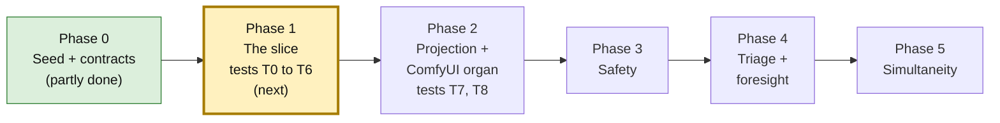
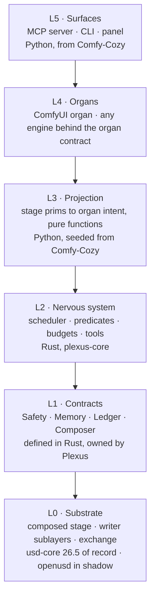
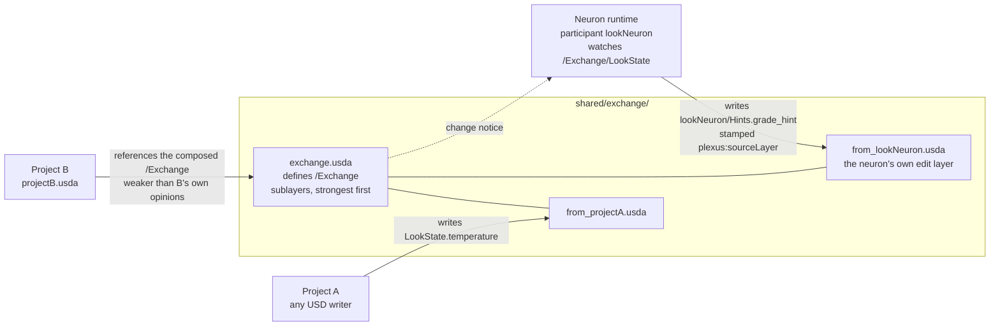
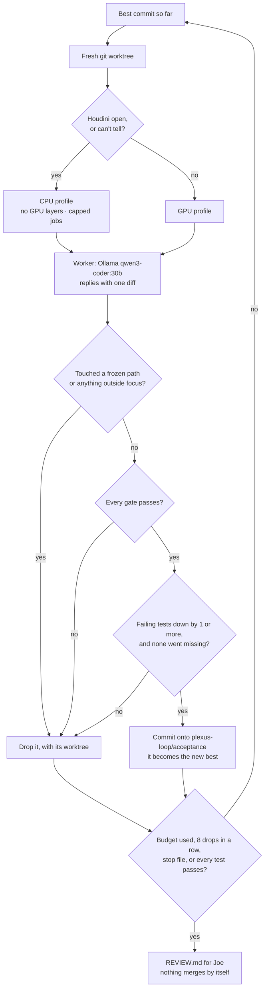

# Plexus

**Projects that compose into each other while they run.**

Plexus is a runtime where **OpenUSD composition is the source of truth.** Agents, called **neurons**, stay asleep until a cheap, exact check on the stage fires. Render and compute engines plug in as swappable **organs**.

*Plexus is a working title.*

---

## Where it stands · Nov 1, 2026

| Done | Not yet |
|---|---|
| Seeded from Comfy-Cozy, with its full history | **Any Plexus runtime code** (`plexus/`, `crates/`) |
| Blueprint v5.3 and Engineering Spec v2.1 | The four contracts and the Cargo workspace |
| Phase 1 acceptance tests, written and frozen (11) | A first harness run |
| The build harness, `harness/plexus_loop/` | |

**Next step:** the first harness mission, `acceptance`, is planned and waiting on Joe's decisions. The plan is [`acceptance.plan.md`](https://github.com/JosephOIbrahim/Plexus/blob/mission/acceptance/harness/plexus_loop/missions/acceptance.plan.md) on the `mission/acceptance` branch.

---

## The idea, in three lines

| Idea | What it means in practice |
|---|---|
| **The stage is the truth** | Every project is a USD layer. Composition settles conflicts. No locks, no merges, no hidden runtime state. |
| **Wake only when needed** | A neuron sleeps until its predicate fires, for example `delta(/Exchange/LookState.temperature) > 0.2`. A budget caps how often it can wake. |
| **Engines are organs** | ComfyUI, Houdini or anything else sits behind one organ contract, so it can be swapped. |

---

## You are here



---

## How it fits together

**Each layer calls only the layer below it, or a contract.** Rust goes where code is hot, long-running or must be exact. Python stays where code must be flexible or already exists.



**When something Plexus depends on is missing, the call says so.** It never reports success from a stub. Safety fails closed, memory narrows to the local stage, and the ledger queues claims for later.

---

## The first slice (Phase 1)

**Two projects meet only through one shared exchange.**

1. Project A changes a value.
2. Project B sees the change in under 250 ms.
3. A neuron wakes and writes a hint into its own layer.
4. B sees the hint, stamped with the layer it came from.



### The tests that define "done"

They live in `tests/acceptance/` and are frozen: only Joe may change them.

| Test | In plain words |
|---|---|
| **T0** · Schema gate | The four Plexus schemas register in USD, and every attribute survives a save and reload. |
| **T1** · Propagation | A's change shows up in B in under 250 ms (95th percentile over 50 tries). |
| **T2** · Predicate precision | A 0.3 change wakes the neuron once, a 0.1 change never does, and two 0.15 changes wake it once. A bad predicate fails at registration. |
| **T3** · Budget | Too many wakes trip the budget. Three trips in a row mute the neuron, visibly. |
| **T4** · Provenance | The neuron's hint names the layer it came from, and B's property stack agrees. |
| **T5** · Gate | A write outside the neuron's allowlist is dropped and flagged. One inside lands. |
| **T6** · Truth | Kill both processes, reopen the files, and every value is still there. |
| T7 · Round trip *(Phase 2)* | A job goes through the ComfyUI organ and comes back only once the engine's history really has it. The stage holds the file's path and hash, never its bytes. |
| T8 · Blindness *(Phase 2)* | No ComfyUI vocabulary appears outside the ComfyUI organ. |

More pictures, including the wake pipeline and the proposed Python/Rust split: **[docs/plexus/DIAGRAMS.md](docs/plexus/DIAGRAMS.md)**.

---

## How Plexus gets built

**Claude plans and reviews. A local model makes the attempts. Joe decides what gets promoted.**



### Run it

**Step 1 of 3 · Check the mission.** Says whether the next attempt would run on the CPU or the GPU.

```
python -m harness.plexus_loop check harness/plexus_loop/missions/acceptance.toml
```

**Step 2 of 3 · Run it.** Works until a budget or a stop condition ends it.

```
python -m harness.plexus_loop run harness/plexus_loop/missions/acceptance.toml
```

**Step 3 of 3 · Stop it early, if you need to.** The run halts after its current attempt.

```
python -m harness.plexus_loop stop
```

**From Claude Code,** the same loop has three commands:

| Command | What it does |
|---|---|
| `/doctor` | Checks Ollama and the model, Rust, maturin, usd-core 26.5, Houdini, and the harness. |
| `/mission acceptance` | Setup, plan, stop for Joe, then run and review on his go. |
| `/report` | Writes the mission report and refreshes `harness/CAPSULE.md`. |

### What you need

| Tool | Version | Why |
|---|---|---|
| Python | 3.11 or newer (3.14 is used today) | Host process |
| usd-core | 26.5 exactly, `pip install -e ".[dev,stage]"` | Composer of record; matches Houdini 22's USD 0.26.5 |
| Rust + maturin | stable Rust, maturin 1.x | Once `crates/` lands, for `plexus._core` |
| Ollama | with `qwen3-coder:30b` pulled | The harness's default worker |

---

## Where things live

| Path | What it is | Who may change it |
|---|---|---|
| `plexus/` | New Plexus Python *(not created yet)* | The worker, through the harness |
| `crates/` | Rust core, exposed as `plexus._core` *(not created yet)* | The worker, through the harness |
| `tests/acceptance/` | The frozen judge, plus `CONTRACT.md`, the Python surface the tests call | Joe only |
| `harness/plexus_loop/` | The build harness, its `program.md` and mission files | Joe, and Claude when Joe says so |
| `docs/plexus/` | Blueprint v5.3, memory options, diagrams, the Nov 1 package | Joe |
| `PLEXUS_SPEC.md` | Engineering Spec v2.1 + Patch 01 | Joe |
| `agent/`, `cognitive/`, `panel/`, … | Comfy-Cozy seed code, now Plexus's own | See `CLAUDE.cozy.md` |

---

## Rules that don't bend

- **Nothing from Synapse comes into Plexus.** No code, imports, packages, shared contracts or dependencies. It is one architectural reference among several.
- **Plexus runs without SALUS, Moneta and Hanish.** Each is optional, behind an adapter Plexus writes.
- **Branches only.** Nothing pushes to `main` or merges into it. Main moves by pull request.
- **The frozen tests define done.** Nothing edits, skips or re-marks them except Joe.
- **Houdini open, or can't tell? Then CPU.** The harness does this itself.

The hooks in `.claude/settings.json` enforce these. `CLAUDE.md` explains them.

---

## Read next

| If you want… | Read |
|---|---|
| The architecture and its decisions | [`docs/plexus/PLEXUS_BLUEPRINT_v5.md`](docs/plexus/PLEXUS_BLUEPRINT_v5.md) |
| Exactly what gets tested | [`PLEXUS_SPEC.md`](PLEXUS_SPEC.md) and [`tests/acceptance/CONTRACT.md`](tests/acceptance/CONTRACT.md) |
| Every diagram in one place | [`docs/plexus/DIAGRAMS.md`](docs/plexus/DIAGRAMS.md) |
| How the harness works | [`harness/plexus_loop/README.md`](harness/plexus_loop/README.md) and [`program.md`](harness/plexus_loop/program.md) |
| Where the last session stopped | [`harness/CAPSULE.md`](harness/CAPSULE.md) |

---

## Comfy-Cozy, the seed

Plexus started as a clone of Comfy-Cozy, with its history, and that code is Plexus's own now. **The Comfy-Cozy README moved to [`README.cozy.md`](README.cozy.md).** Its conventions are in [`CLAUDE.cozy.md`](CLAUDE.cozy.md).

## License

MIT. See [`LICENSE`](LICENSE). Comfy-Cozy's MIT notice is kept.
