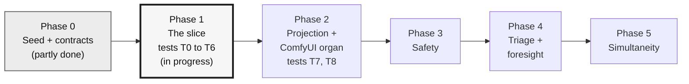
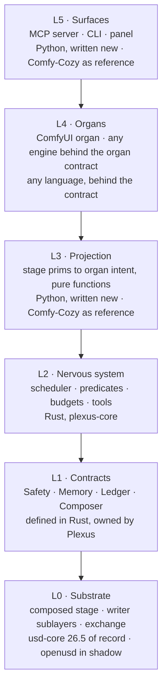
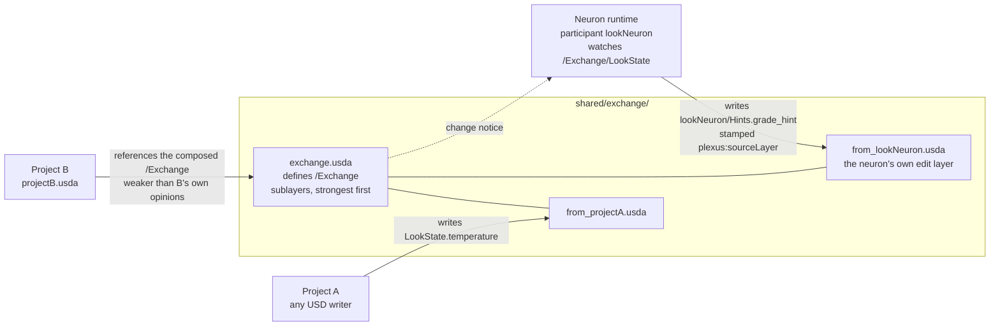
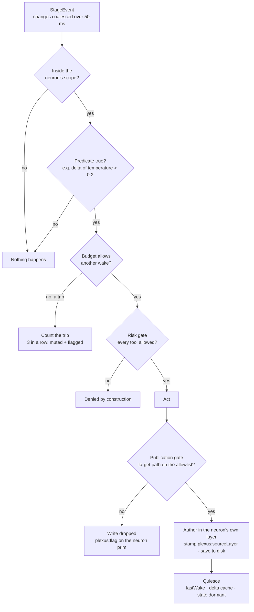
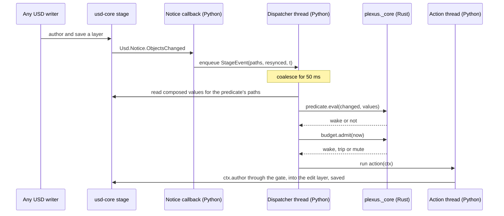
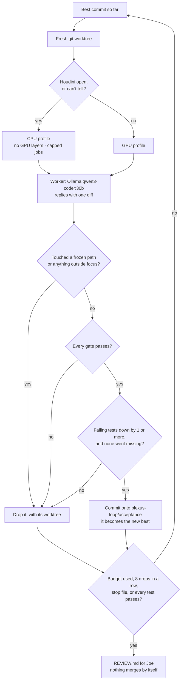

# Plexus · Diagrams

**Six pictures of how Plexus is meant to work.** Each one has a single job, stated above it.

They follow Blueprint v5.3 (`docs/plexus/PLEXUS_BLUEPRINT_v5.md`), with the Nov 1 Comfy-Cozy decision (draft v5.4, `BLUEPRINT_v5.4_DRAFT_CHANGES.md` B5), and Engineering Spec v2.1 (`PLEXUS_SPEC.md`). Where a diagram shows something not yet decided, it says so in its title.

GitHub draws these directly. In other viewers, paste a block into [mermaid.live](https://mermaid.live).

| # | Diagram | Answers |
|---|---|---|
| 1 | [Roadmap](#1--roadmap-you-are-here) | Where are we? |
| 2 | [Layers](#2--layers) | What sits on what, and in which language? |
| 3 | [The slice](#3--the-slice-phase-1) | What does Phase 1 prove? |
| 4 | [Wake pipeline](#4--wake-pipeline) | What happens when the stage changes? |
| 5 | [Notice path](#5--notice-path-rust-and-python) | Where does Python stop and Rust start? |
| 6 | [Build harness](#6--build-harness) | How does Plexus get built? |

---

## 1 · Roadmap: you are here

**Phase 0 is partly done** (the seed, the frozen tests, the harness and the `plexus/` + `crates/` scaffold exist; the four contracts don't yet). **Phase 1 is in progress.** The thicker the outline, the nearer the work; green is kept for done, and nothing here is done yet.

<!-- plexus:status -->
**Phase 1 · 2 of 11 frozen tests pass** (T0, the schema gate; T1, propagation) · Nov 3, 2026
<!-- /plexus:status -->

---

## 2 · Layers

**Each layer calls only the layer below it, or a contract.** Rust goes where code is hot, long-running or must be exact. Python stays where code must be flexible, or where what Plexus calls is Python-only: usd-core (Pixar ships no official Rust bindings) and the LLM SDKs.

**If a contract's backend is missing,** the call says so instead of pretending:

| Contract | When its backend is absent |
|---|---|
| Safety | **Fails closed.** Nothing runs. |
| Memory | **Narrows.** Answers from the local stage only, and says so. |
| Ledger | **Outbox.** The claim is kept and sent later. |
| Composer | **Fails closed.** No composer of record, no stage. |

---

## 3 · The slice (Phase 1)

**Two projects meet only through one shared exchange.** Project A changes a value. Project B sees it. A neuron wakes and writes a hint into its own layer, and B sees the hint too, with a stamp saying where it came from.

**One writer per layer.** Nobody edits another writer's sublayer. Composition, not application code, decides whose opinion wins.

---

## 4 · Wake pipeline

**A neuron runs only when every check on the way says yes.** The order is fixed (Spec §6).

**Three details that matter:**

- **The delta cache updates only on a wake.** Small changes add up until they cross the threshold.
- **A mute is never silent.** It is an opinion on the neuron prim, with a `plexus:flag…` attribute beside it.
- **Every opinion is saved as it lands.** Reopening the files reproduces the whole session.

---

## 5 · Notice path: Rust and Python

**Option A, decided by Joe on Nov 1. Option B (all Python for Phase 1) was the alternative.** Python keeps the threads and everything that touches `pxr`. Rust (`plexus._core`) keeps the pure logic: compiling and evaluating predicates, and counting budgets. Only plain data crosses between them.

**Option B** keeps all of this in Python for Phase 1 and moves predicates and budgets to Rust in the next mission, behind the same surface. The trade-off is in §4 of the [`acceptance` mission plan](https://github.com/JosephOIbrahim/Plexus/blob/mission/acceptance/harness/plexus_loop/missions/acceptance.plan.md) on the `mission/acceptance` branch.

---

## 6 · Build harness

**Claude plans and reviews. A local model makes the attempts. Joe decides what gets promoted.** An attempt is kept only when it is a strict gain.

**Who may touch what:**

| Surface | Path | Who |
|---|---|---|
| **Judge** | `tests/acceptance/` | Joe only. Hooks and the harness both enforce it. |
| **Editable** | `plexus/**`, `crates/**`, `Cargo.toml`, `Cargo.lock` | The worker, through the harness |
| **Program** | `harness/plexus_loop/program.md`, mission files, plans, `CLAUDE.md` | Joe, and Claude when Joe says so |
