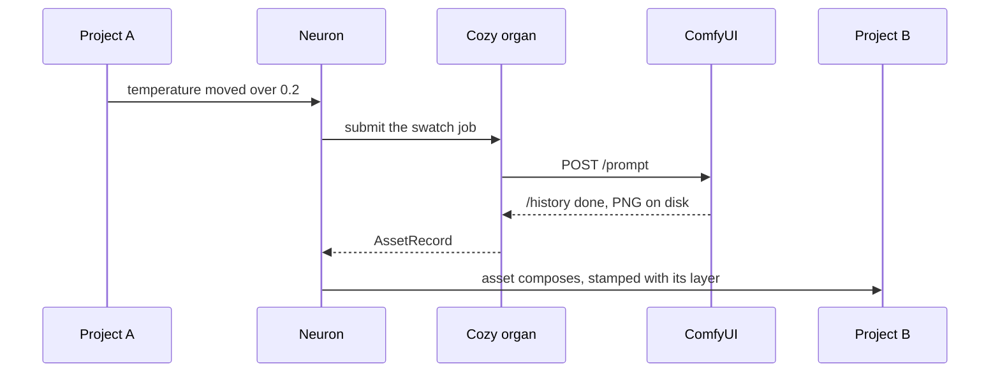

# Plexus Live

One click starts ComfyUI with your models, and then a Plexus session you drive from a terminal.

```
python examples/plexus_live.py
```

Or double-click `Plexus Live` on the desktop.

## What it does

1. It builds the Rust core if it is missing or older than the crates. The build stays in the repo's own `target/`, never in the harness's.
2. It starts `G:\COMFY\ComfyUI` in its own window, unless ComfyUI already answers on 8188, and waits for `/system_stats`. If ComfyUI fails in that window, it says so at once and leaves the window open. If another launcher's start is still loading, it waits for that one and starts nothing.
3. It checks the checkpoints ComfyUI lists sit under `G:\COMFYUI_Database\Models`.
4. It opens a new session folder under `%LOCALAPPDATA%\Plexus\sessions` and gives you a prompt.

## The session

Two projects, one exchange, one neuron watching `/Exchange/LookState.temperature`, and one organ: ComfyUI.

**The loop, end to end.** Project A writes the temperature. A move over 0.2 wakes the neuron. It writes a grade hint, sends ComfyUI a job through the Cozy organ, and authors the file that comes back as a `PlexusAssetAPI` asset at `/Exchange/lookNeuron/Assets/swatch`, in its own layer. Project B composes the hint, the asset and the layer it came from.



**The job is a swatch by default:** a 256 by 256 square whose colour follows the temperature, cool blue at 0 to warm orange at 3. It needs no model, so it runs in about 10 s even with ComfyUI on the CPU. `--workflow graph.json` sends any graph exported with ComfyUI's Save (API) instead, with the neuron's wake count as its seed. A job that fails lands as a `render` line on the stage, `failed: …`, and the neuron goes back to dormant.

| Command | What it does |
|---|---|
| `temp 1.5` | Project A writes the temperature; over 0.2 the neuron wakes and ComfyUI renders |
| `status` | ComfyUI, the organ, the neuron, and what project B reads: the hint, the render line and the asset |
| `help` | The list |
| `quit` | Stops the neuron and leaves ComfyUI running |

Run it without the prompt: `python examples/plexus_live.py --script "temp 1.5; status; quit"`.

## What it does not do yet

- **The organ is not on the stage.** Project B sees each asset and the layer it came from, but not which organs exist or what they can do. Authoring a `PlexusOrganAPI` prim needs a runtime call that does not exist yet.
- **One neuron, one organ, one job at a time.** `temp` waits for the wake's job, up to its 600 s deadline, before the prompt comes back, so a slow job holds the prompt. Ctrl+C stops the session.
- **One asset prim.** Each wake writes `/Exchange/lookNeuron/Assets/swatch` again, so the stage holds the latest job's record; earlier files stay in the session's `assets` folder. After a failed wake, the asset is still the last good one and the `render` line says `failed`.

## Why it does not use comfyui_launcher.bat

That file's countdown calls `choice /c " qo"`. Windows rejects the space with "Invalid choice", so the file always stops at its Options menu waiting for a key. The launcher runs the file's Stable command with the file's environment instead, so `COMFYUI_ENV` in `plexus_live.py` has to follow that file by hand.

## Flags

| Flag | What it does |
|---|---|
| `--minimized` | ComfyUI's window starts minimized and never takes the focus |
| `--stop-comfyui-on-exit` | Stops ComfyUI when the session ends, only if this launcher started it. A window that failed stays open, so its log can be read. |
| `--script "a; b"` | Runs commands instead of the prompt |
| `--workflow graph.json` | Sends this ComfyUI API-format graph on each wake, instead of the swatch |
| `--no-organ` | The neuron writes its grade hint only, and sends ComfyUI nothing |
| `--timeout 300` | Seconds to wait for ComfyUI to answer |
| `--comfyui-root`, `--models-root`, `--url`, `--sessions-root` | Point it somewhere else. `--url` needs http or https, a host and a port. If nothing answers there, the launcher starts ComfyUI on that port, and only at an http URL on this machine. |
